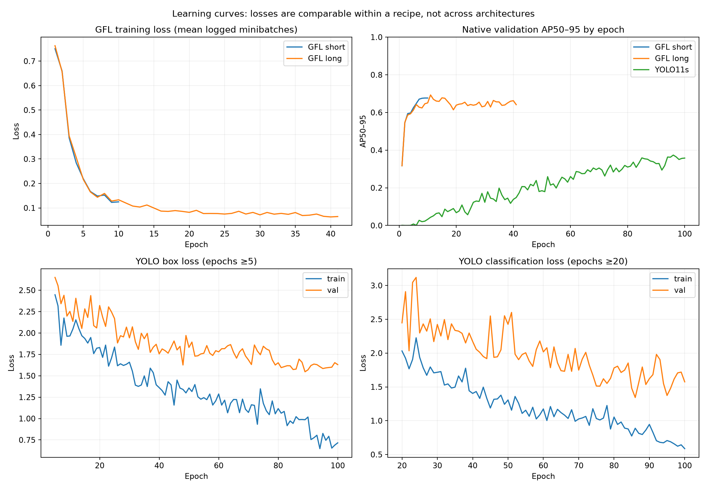

# Three-run comparison: what the evidence establishes

Audit date: 2026-11-01. No model was trained or modified for this comparison. We located and evaluated Anant's actual saved YOLO checkpoint, rather than relying on teammate-reported metrics. Scope is decoy-only YOLO Run1 (`runs/deer/weights/best.pt`), not his later decoy+AWIR recipe.

## Verdict

The longer GFL checkpoint is the strongest current candidate for detection/count accuracy on this shared validation partition. Both GFL checkpoints substantially outperform the saved YOLO11s checkpoint under one evaluation implementation. This is a real measured difference on these images, not proof that GFL generalizes better to new flights or that the YOLO family has a lower performance ceiling. YOLO is much smaller and faster; the operational choice depends on required recall and runtime.

## Were the data and properties identical?

| Property | Audit result |
|---|---|
| Source images/labels | 264 images, 146 boxes, one deer class; current files hash-identical to GFL's recorded inventory. All 146 converted boxes were checked: zero coordinate difference from direct YOLO-to-COCO conversion. |
| Training | Same 211 images / 112 boxes for both GFL runs; YOLO saved training args point to this same committed decoy dataset. No historical dataset hash is embedded in YOLO checkpoint, so historical identity is strongly supported by configuration/source evidence rather than independently reconstructable from weights. |
| Validation | Same 53 images / 34 boxes for this direct checkpoint comparison; 18 positive images, 35 negative. |
| Test | **None.** No independent test partition was used. GFL config has a test placeholder but its test.json does not exist; it was not evaluated. Older unrelated split metadata is not this experiment's test data. |
| Dataset conversion | Format only: normalized center/width/height to pixel top-left/width/height; class0 -> COCO category1. Image pixels not altered in conversion. |
| Training preprocessing | **Different.** GFL fits within a 1280x854 aspect-preserving resize bound, normalizes and pads to min96/stride32. YOLO trains with imgsz1280, square letterboxing/mosaic and its own normalization. Both saying1280 does not mean identical tensors/object sizes. |
| Augmentation | GFL horizontal/vertical flips .25/.25. YOLO saved config: horizontal .5, vertical0, mosaic1, scale.5, translate.1, HSV jitter; close_mosaic10. These create materially different training distributions. |
| Optimization/seed | GFL SGD LR.00025, batch1, seed42; YOLO optimizer=auto, AutoBatch, seed0. Both COCO initialized, but different pretrained architectures/weights. Not matched compute or parameter budget. |
| Schedules | Short GFL10epochs, drops6/8. Long GFL100max, drops60/80, AP patience30, stopped41; milestones never reached. YOLO100epochs/patience30, completed100. |

GFL short and long are the same detector architecture under two training schedules, not two independent detector families. One seed per recipe and one recovery from epoch13 do not establish repeated-run stability or bitwise reproducibility.

## Common direct evaluation

All saved predictions now use the same ground truth and shared pycocotools AP / greedy one-to-one IoU.5 P/R/F1/count evaluator. Every model gets its own confidence calibrated by the SAME validation F1/count/tie rule. Score floor .001, NMS IoU .6 and max300 detections are shared; AP uses COCO's standard maxDet100. Native model preprocessing and framework candidate handling remain different, appropriate to comparing these deployed pipelines but not an isolated architecture ablation. YOLO predictions were freshly exported; GFL's saved predictions used these settings already. No inference augmentation.

| Metric | YOLO11s, best epoch96 | GFL short, exported epoch4 | GFL longer, epoch11 |
|---|---:|---:|---:|
| Precision | .8000 | .9143 | .9412 |
| Recall | .7059 | .9412 | .9412 |
| F1 | .7500 | .9275 | .9412 |
| AP50 | .7587 | .9501 | .9443 |
| AP50–95 | .3660 | .5991 | .6925 |
| TP / FP / FN | 24 / 6 / 10 | 32 / 3 / 2 | 32 / 2 / 2 |
| Count MAE per image | .26415 | .09434 | .07547 |
| Exact count accuracy | 77.36% | 90.57% | 92.45% |
| Confidence | .28 | .34 | .41 |

YOLO's original native best-epoch96 log instead reports P.68414/R.76447/AP50.73358/AP50–95.37375. Those reporting conventions, NMS(.7 during native validation), matching/AP implementation and operating threshold differ. Do not mix the old native YOLO row with the new shared-evaluator row. Neither native nor shared P/R alone is a universal ranking independent of threshold.

35 negatives make overall exact-count accuracy easier: predicting no deer everywhere would score66.04%. Among the18 positive images, exact counts are7/18 YOLO,14/18 short GFL and15/18 long GFL. All three have one negative image with a false alarm. GFL's principal count advantage is on deer-containing images. Count totals alone can conceal compensating misses/false positives; use TP/FP/FN as well.

### Important checkpoint-selection correction

The short run's best-F1 hook only saves on STRICT F1 improvement, so it retained epoch4 while later epochs tied F1 with better localization. Fresh evaluation of its saved best-AP epoch9 gives P.9143/R.9412/F1.9275/AP50.9454/AP50–95.6758 (threshold.45).

Thus longer GFL versus the best-localizing short checkpoint improves AP50–95 by only **1.67 percentage points**, and removes **one false positive**, with no recall gain. The earlier59.9->69.2 comparison exaggerates the training-budget benefit because it also changes which checkpoint is exported. Retain both original results; do not silently replace weights. For future runs predeclare a checkpoint rule, e.g. best F1 with AP as tie-breaker or a recall-constrained metric.

## Losses, plateau and overfitting

Loss values across detector families are NOT comparable: definitions, weights, batch averaging and augmentations differ. GFL logs mean sampled training minibatches and detection metrics, not validation losses. YOLO records both train and validation losses; augmentation makes a raw train/val gap imperfect evidence of memorization.

- Short GFL: mean logged train loss .7507->.1248; native validation AP50–95 .3170->.6767 through10epochs. No clear late validation deterioration. F1 reaches .9275 at4, ties through much of the remaining training, while boxes improve.
- Long GFL: best AP .6930 at11 with train loss .1204. At20/30/41, train loss .0819/.0717/.0648 while AP .6387/.6342/.6415; F1 remains near .94 before .9275 at41. This is consistent with overfitting/continued specialization after11, not useful monotonic improvement. Early stopping saved the earlier better weights. This does not quantify real-flight generalization.
- YOLO: epochs20/60/100 native AP50–95 .06795/.25976/.35787, best.37375 at96. Train box1.830->1.287->.716; validation box2.322->1.780->1.630. Train cls2.032->1.174->.587; validation cls2.447->2.017->1.575. A generalization gap exists, but validation metrics broadly improve toward the end: no strong sustained collapse demonstrating YOLO has reached its ceiling. Mosaic closes for the last10epochs, affecting the late training-loss drop. More training/tuning might help; no gain is guaranteed.

These curves refute a claim that simply training GFL longer always helps. They support keeping the selected checkpoint and investigating data/generalization next. They cannot distinguish good visual learning from same-site memorization without a genuinely unseen evaluation set.

## Capacity and runtime

GFL has approximately53.3M parameters versus YOLO's9.43M (~5.65x). Separate same-GPU measurements give YOLO .02765s/image versus GFL .1220-.1291s/image (roughly4.4-4.7x faster for YOLO). These include loading/inference/postprocessing, one warmup excluded; frameworks/PyTorch/CUDA versions and measurement times differ. This is an approximate pipeline speed comparison, not a controlled latency benchmark or a guaranteed video frame rate. YOLO's recorded100epoch loop took884s (~14.7min), excluding setup. Epoch counts therefore do not represent equal compute.

## Relationship to the research

Moreni et al. (2023) report average GFL F1 around.96-.97 and mAP around.77/.89 on their datasets. Their real aerial red deer, backgrounds and flight-grouped splits differ from our decoys and random page split. Their ten-epoch recipe used2650x1768 inputs,500warmup,6/8decays, eight learning rates and best-of-five training; they explicitly did not include an independent test. Our decoy runs used one fixed LR, smaller resize and one run per schedule. Our backbone is a documented reconstruction, not a confirmed author configuration. The paper supports investigating GFL; it does not establish that our lower/higher raw metrics replicate or beat their model, or beat YOLO11, which they did not compare. Their key message that counting and localization metrics can rank models differently is visible in our F1-tied checkpoints. Source: [Moreni et al., PLOS ONE](https://journals.plos.org/plosone/article?id=10.1371/journal.pone.0284449).

## Limitations and next decision

1. Shared validation has only34deer; one deer changes recall by2.94percentage points. It was repeatedly used for checkpoint and threshold selection. No independent uncertainty estimate or repeated seeds supports a universal ranking.
2. Random page splits do not enforce flight/scene separation. Similar views/backgrounds may cross partitions, benefitting models differently. Hash equality checks conversion, not absence of near-duplicate leakage.
3. User-identified oversized boxes limit localization targets; keep class/point correctness separate. Box overlap may contribute to overlapping predictions but is not a confirmed root cause; inspect NMS/errors. Do not resurrect withdrawn missing-species claims.
4. Plastic decoys and rendered PDF crops differ from the eventual1080p camera/flight/GSD. Matching a nominal resolution does not match target pixel size or scene distribution.
5. Capacity, optimizer, augmentations, seed, checkpoint criterion and compute differ. This is a comparison of trained systems on common data, not evidence that GFL architecture alone caused the gain.
6. We evaluated Anant's decoy-only saved checkpoint, not all his later runs or YOLO family sizes. His log still improves late; testing appropriate augmentation, controlled tuning and a larger YOLO is reasonable if runtime allows.

Recommendation: retain longer GFL as the accuracy candidate and YOLO11s as the speed candidate. Freeze these checkpoints and thresholds; collect/hold out a new flight/site before any model or threshold tuning on it. Jointly review/version boxes and flight-grouped train/val/test data. Use the same evaluator, original-pixel predictions, error/count breakdowns and controlled on-device latency. If labels/training change, retrain all candidates against the same version and compare multiple seeds under an agreed tuning/compute budget. The current validation advantage is substantial, but **we have not established that GFL generalizes better**.

## Reproducibility / artifacts

Server comparison outputs: `/home/mrd/gfl_workspace/comparison/`. Local ignored outputs: `artifacts/model_comparison/`. Committed common_validation_metrics.json records ground-truth SHA and measured settings; yolo_checkpoint_metadata.json identifies the actual checkpoint. GFL checkpoint hashes are in ../RESULTS.md. No weights or full datasets were added to Git.

Export with scripts/compare_yolo_predictions.py in the YOLO venv; evaluate with scripts/evaluate_three_saved.py --workspace WORKSPACE in the GFL venv from repo root. Render saved histories with scripts/render_comparison.py --artifacts artifacts/model_comparison. Scripts do not retrain. The fourth diagnostic row is the short run's already-saved best-AP checkpoint.
